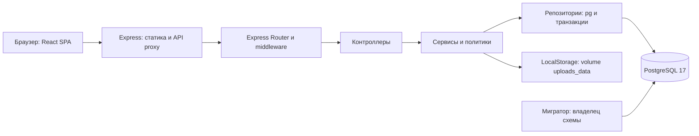

# Анализ Workify и выполненные доработки — 25.10.2026

> Отдельный набор SQL-тестов БД (`scripts/test-database.mjs` и `database/tests`) удалён при упрощении миграций. Упоминания ниже описывают проверки на момент аудита.

Проверено приложение из каталога `приложение`, ветка `main`, версия 1.1.0. Исследованы исходники, зависимости и lock-файлы, маршруты Express, схема PostgreSQL, проверки и Docker Compose. Исправления выполнены и проверены; рабочие пользовательские базы и volumes не участвовали в тестах.

## 1. Архитектура

Трёхуровневое клиент-серверное приложение: React SPA, монолитный HTTP API и PostgreSQL. Сервер статики и прокси frontend — отдельный процесс Express. Docker Compose запускает три постоянных сервиса и одноразовый мигратор. Микросервисов и внешнего брокера нет.

Распределение ответственности:

| Слой | Что делает | Точка входа |
|---|---|---|
| Сборка зависимостей | Конфигурация, pg Pool, сервисы, маршрутизатор, запуск и shutdown | [server.js](../backend/src/server.js) |
| HTTP-приложение | Общие middleware, JSON parser, `/api`, 404 и обработка ошибок | [app.js](../backend/src/app.js) |
| Router | URL, метод, авторизация, валидация и выбор контроллера | [routes/index.js](../backend/src/routes/index.js) |
| Контроллер | Проверенный HTTP-ввод → сервис → HTTP-ответ | [controllers](../backend/src/controllers) |
| Сервис | Права, статусы, бизнес-правила, координация одной транзакции | [services](../backend/src/services) |
| Repository/DAO | Параметризованный SQL, pg Pool/Client, блокировки | [repositories](../backend/src/repositories) |
| Хранилище | Байты файлов, безопасные имена, чтение и удаление | [local-storage.js](../backend/src/storage/local-storage.js) |

Фабрики принимают зависимости аргументами; импорт приложения не открывает порт или соединение с БД. SQL сосредоточен в репозиториях. Контроллеры не содержат основной бизнес-логики. Для курсового такое разделение достаточно; добавление новых инфраструктурных слоёв для уже работающего workflow не требуется.

## 2. Технологии и фреймворки

Версии взяты из package.json и lock-файлов после исправлений.

| Часть | Используется | Назначение |
|---|---|---|
| Язык и среда | JavaScript ES modules, Node.js 24 LTS в контейнерах | Backend, сервер frontend, скрипты |
| Backend | **Express 5.3.0** | HTTP server и Router |
| База | PostgreSQL 17, `pg` 8.23.1 | SQL и пул соединений, без ORM |
| Авторизация | `argon2` 0.45.1, `jose` 6.2.12 | Argon2id, JWT, проверяемые сервером сессии |
| HTTP-защита | `helmet` 8.3.0, `express-rate-limit` 8.7.1 | Заголовки и лимиты запросов |
| Файлы | `multer` **2.5.0**, `file-type` 22.2.0 | Multipart, ограничения, определение сигнатур |
| JSON parser | `body-parser` **2.4.0**, транзитивно через Express | Исправленная обработка тела запроса |
| Интерфейс | React и React DOM 19.3.1 | Компоненты, hooks, React.lazy/Suspense |
| Сборка | Vite 8.3.4 | Production build и локальная разработка |
| Сервер frontend | Express 5.3.0, `http-proxy-middleware` 4.2.0 | Статика, SPA fallback, `/api` proxy |
| Оформление | Собственные CSS и токены, Inter, локальные Heroicons SVG | Адаптивность, RU/EN, светлая/тёмная темы |
| Проверки | Встроенный `node:test`, Playwright 1.64.1, SQL assertions | Unit, integration, браузерные сценарии |
| Инфраструктура | Docker и Docker Compose | Сборка, запуск, health-checks, volumes |

TypeScript, NestJS, Next.js, React Router, Redux, Prisma, Sequelize, Tailwind, Redis и MinIO в рабочем приложении не используются. Навигация реализована поверх History API; переводы и предпочтения — собственными небольшими модулями. Технологии в соседних учебных материалах не относятся к этому приложению.

## 3. Backend

В `backend/src`: 16 предметных Router + агрегатор `routes/index.js`, 17 контроллеров, 19 файлов сервисов + 7 вспомогательных файлов, 20 репозиториев + проекция источника и транзакционная обёртка, 7 файлов middleware, 18 файлов валидаторов. Фактически зарегистрирован **101 маршрут «метод + путь»**; полный список находится в приложении к отчёту.

Предметные блоки: health; авторизация; профиль/навыки/пароль; файлы/аватар; портфолио; проекты; отклики; исполнители; приглашения; заказы; версии результата/доработки/приёмка/сроки/отмена; отзывы; жалобы; предупреждения; администрирование аккаунтов и жалоб; аудит/архив; уведомления.

### Middleware и обработка запроса

Глобальный порядок: `requestId` → `auditContext` → Helmet → `express.json` → `/api` → `notFound` → `createErrorHandler`.

| Файл/механизм | Назначение |
|---|---|
| `middleware/request-id.js` | Генерация серверного идентификатора запроса |
| `utils/audit-context.js` | AsyncLocalStorage с requestId/IP для аудита |
| Helmet | Защитные HTTP-заголовки |
| `express.json` | Строгий JSON, лимит 64 KiB по умолчанию |
| `middleware/auth.js` | `authMiddleware`, `roleMiddleware`, `authCsrf` |
| `middleware/validate.js` | Валидация body/query/params в отдельный `request.validated` |
| `express-rate-limit` | Ограничения входа, загрузок и предметных команд |
| `middleware/upload.js` | Один файл до 10 MiB, до четырёх активных загрузок |
| `middleware/audit-upload.js` | Импорт одного JSON-архива до 2 MiB |
| `utils/async-handler.js` | Передача ошибок async-контроллеров общему обработчику |
| `middleware/not-found.js` | JSON 404 для API |
| `middleware/error-handler.js` | Безопасный конверт ошибок, SQLSTATE → HTTP, без раскрытия SQL/секретов |

В отдельных публичных маршрутах авторизация необязательна, если заголовка Bearer нет; защищённые операции требуют сессию и роль. CLIENT — одна системная роль для заказчика и исполнителя: режим определяется сторонами конкретного заказа. ADMIN имеет отдельные права модерации.

### Проверенные свойства

- Пароли хешируются Argon2id; JWT проверяется по подписи, алгоритму, issuer/audience и сроку. Актуальность сессии и блокировка проверяются по БД.
- Refresh token — случайное значение; в БД хранится SHA-256. Ротация одноразовая, повторное использование отзывает сессию. Cookie HttpOnly/SameSite=Strict, Secure включается настройкой HTTPS.
- Изменяющие cookie-зависимые auth-запросы защищены пользовательским заголовком и проверкой cross-site. Основные предметные команды используют Bearer из памяти клиента.
- Валидаторы разрешают только известные поля, ограничивают строки, массивы, UUID, суммы, даты, фильтры и пагинацию; SQL-значения передаются параметрами.
- Изменяющие операции повторно проверяют пользователя и статус под блокировками. Общий порядок users → project → order/source сериализует конфликтующие действия.
- Назначение через отклик и приглашение использует общий AssignmentService. Заказ, снимок условий, события, аудит и уведомления создаются одной транзакцией.
- Файл проверяется по расширению, MIME, сигнатуре и размеру. Доступ проверяется перед выдачей; uploads не раздаётся публичным каталогом. Отложенное удаление повторяется после сбоев.
- Отмена сохраняет прежний заказ и открывает проект для нового назначения; старые стороны, результаты и файлы не переходят новому исполнителю.

## 4. Frontend

[main.jsx](../frontend/src/main.jsx) собирает App, восстановление сессии, общий каркас и выбор экрана. [navigation.js](../frontend/src/navigation.js) хранит стабильный snapshot URL, обрабатывает pushState/popstate; [Navigation.jsx](../frontend/src/Navigation.jsx) предоставляет Link/useLocation/RouteFocus. Внутренние переходы сохраняют HTML-документ; Ctrl/Cmd, внешние ссылки, файлы и якоря сохраняют поведение браузера.

Состояние страниц хранится в React hooks; фильтры и страницы списков — также в URL. При смене URL/пользователя содержимое пересоздаётся, при смене языка/темы форма сохраняется. API-клиент держит access token в памяти, объединяет refresh-запросы, использует Web Locks между вкладками и BroadcastChannel для выхода, повторяет запрос после 401 не более одного раза.

Общие части: ошибки/пагинация/загрузка в Ui, Icon, FileLink/AvatarEditor, ImageAttachments, Preferences и три варианта навигации. Крупные страницы теперь подключены через React.lazy/Suspense. Полный перечень всех 25 JSX-файлов и их именованных компонентов/экспортов приведён ниже.

Интерфейс собственного изготовления: CSS tokens, адаптивные карточки и формы, доступные подписи, aria-состояния, focus и ссылка к основному содержимому. Уведомления опрашиваются раз в минуту и при фокусе. RU/EN относятся к интерфейсу; пользовательские описания и тексты отзывов не переводятся.

## 5. База данных

Схема `workify`: **32 таблицы, 5 представлений, 8 миграций**. UUID, timestamptz, numeric(12,2), FK/PK/CHECK/UNIQUE, частичные уникальные индексы и технические триггеры. Бинарные файлы находятся в uploads_data; БД хранит метаданные и связи. Детальная ER-модель: [database.md](database.md).

| Группа | Таблицы |
|---|---|
| Аккаунты и профиль | users, profiles, skills, user_skills |
| Портфолио | portfolio_items |
| Проекты и подбор | categories, projects, project_skills, proposals, project_invitations |
| Заказы и история | orders, order_submissions, order_deadline_requests, order_events |
| Репутация и модерация | reviews, complaints, moderation_actions, warnings |
| События и аудит | notifications, audit_logs, audit_imported_entries |
| Файлы и связи | stored_files, profile_files, portfolio_files, project_files, order_files, submission_files, complaint_files, review_files |
| Авторизация | auth_sessions, auth_refresh_tokens |
| Служебная | schema_migrations |

Представления: `v_active_orders`, `v_order_history`, `v_user_ratings`, `v_public_profiles`, `v_user_sanctions`. Рейтинги заказчика и исполнителя вычисляются раздельно; скрытые отзывы исключаются. Контакты не попадают в публичный профиль.

Миграции: 001 — основная схема; 002 — индексы/представления/seed; 003 — сессии; 004 — жизненный цикл файлов; 005 — расширение профиля; 006 — портфолио/медиа отзывов; 007 — мягкое удаление аккаунта; 008 — импортированный аудит. Мигратор использует advisory lock и транзакцию на каждую версию; повторное применение не меняет справочные ID.

После миграций отдельный [runtime-role.sql](../database/runtime-role.sql) настраивает роль `workify_runtime` с независимым паролем. Владелец схемы и привилегии мигратора в backend не передаются. API не может создавать таблицы, менять миграционный журнал, отключать триггеры или очищать историю. Настройка роли не является девятой миграцией и не меняет таблицы.

## 6. Выполненный план исправлений

Все пункты этого прохода реализованы и проверены.

| Проблема | Выполненное изменение | Подтверждение |
|---|---|---|
| Уязвимые зависимости: body-parser 2.3.0 и Multer 2.4.0 | body-parser 2.4.0 в обоих lock-файлах, Multer 2.5.0 в backend | npm audit: 0 известных уязвимостей в обеих частях; полный Docker workflow |
| Backend подключался к PostgreSQL владельцем-суперпользователем | Отдельная runtime-роль/пароль, минимальные права истории, безопасное дополнение существующего .env | Запреты SQLSTATE 42501 + весь HTTP E2E через реальный ограниченный API |
| DEADLINE_DECIDED терял конкретный смысл в английских уведомлениях | Проверенный outcome без раскрытия metadata; перевод одобрения/отклонения/закрытия | Backend unit + integration на все три решения, frontend unit |
| Все страницы попадали в начальный JS-файл 540,75 kB | React.lazy/Suspense для крупных разделов | Начальный JS 354,51 kB; gzip 106,31 вместо 142,88 kB; 32 браузерных сценария |
| Неизвестный URL показывал главную страницу | Переводимая страница «Не найдено», включая неизвестные административные разделы | Две браузерные регрессии, возврат в каталог без нового документа |
| README и часть docs содержали устаревшие числа/навигацию/настройки | Актуализированы описание БД, проверок, интерфейса и раздельных учётных записей | Сверка со схемой, фактическим Router и результатами прогонов |

Сведения об исправленных уязвимостях: [body-parser GHSA-27r3-jxmh-p828](https://github.com/advisories/GHSA-27r3-jxmh-p828), [Multer GHSA-q7qp-rjg7-q26m](https://github.com/advisories/GHSA-q7qp-rjg7-q26m). В текущем upload middleware fileFilter синхронный; описанная в advisory ветка с асинхронным фильтром здесь не воспроизведена. Обновление удаляет уязвимую версию зависимости.

## 7. Проверка качества и правильности

| Проверка | Результат |
|---|---|
| scripts/test-database.mjs | PostgreSQL 17: чистая установка, повторные миграции/seed, 57 проверок ограничений, представления, рейтинги, rollback, конкурентное назначение — успешно |
| scripts/test-infrastructure.mjs после всех изменений кода | Чистый Compose, отдельная роль БД, 91 backend unit + 142 integration + 16 frontend unit = **249 тестов**, без отказов и пропусков |
| HTTP E2E в том же runner | Оба источника заказа, файлы, версии, доработки, приёмка, отмена, повторное назначение, отзывы, жалобы, модерация, аудит, уведомления — успешно |
| Инфраструктурная устойчивость | Замена контейнеров, сохранность PostgreSQL/uploads, отозванные сессии, остановка БД/backend и восстановление proxy — успешно |
| npm run test:browser | **32/32**: SPA, клиентские/административные экраны, права, формы, RU/EN, темы, 320–1920 px, неизвестные адреса |
| npm run build | Успешно, без предупреждения о чанке более 500 kB |
| npm audit, обе части | 0 известных уязвимостей на дату проверки |
| Git | Изменения разбиты на содержательные коммиты непосредственно в main |

Локальная системная Node.js на момент проверки — 23.6.1; поддерживаемая приложением — 24. Backend проверен на Node.js 24 внутри Docker. На неподдерживаемом локальном runtime один исходный startup-тест не уложился в 5 секунд; в штатном окружении проходит. Для локальной разработки следует использовать версию из engines, для обычного запуска достаточно контейнеров.

## 8. Границы заключения

После исправлений дефектов в выполненных сценариях не обнаружено. Это не доказательство отсутствия любых багов и не заключение о готовности к публичной промышленной эксплуатации.

- Браузерные тесты используют подменённый API; полный реальный workflow проверен отдельно по HTTP через Docker frontend proxy. Единого автоматизированного браузерного workflow с настоящим API пока нет.
- Нагрузочная характеристика не измерялась. Поиск проектов использует буквальное `strpos(lower(...))`; существующий полнотекстовый GIN-индекс этому предикату напрямую не помогает. На текущем объёме замедление не доказано.
- Подтверждение email, самостоятельное восстановление забытого пароля, платежи, отдельный чат, внешние push/email и антивирус не входят в реализованный объём курсового.
- Compose публикует порты только на loopback. HTTPS-терминация, согласованный backup/restore БД и файлов, централизованные метрики и CI не включены в текущий локальный комплект. Сохранность volume после перезапуска не является резервной копией.
- Значительная часть ранее написанных сервисов/JSX имеет плотное форматирование. Код разделён по ответственности, но общих настроек форматтера/линтера пока нет; массовая косметическая перезапись в данный проход не включалась.
- Страница «Не найдено» — клиентское состояние SPA при HTTP 200 для HTML-оболочки; API и отсутствующие ресурсы возвращают HTTP 404.

Это зафиксированные свойства и пределы проверки, а не невыполненные пункты плана этого прохода. Исторические замечания D01/D03 из [аудита требований](assignment-audit-2026-10-24.md) уже закрыты предыдущими коммитами; D04, D09 и актуальные сведения D11 закрыты настоящими изменениями. Исходный отчёт сохранён как снимок состояния на свою дату.

## 9. Полный состав модулей и API

Следующий перечень получен из исходников и фактически собранного Express Router без запуска HTTP-сервера или подключения к пользовательской БД. `/api` включён в пути. Список методов не заменяет матрицу прав в предметных docs: чтение конкретного ресурса может зависеть от владельца, участника, статуса и назначения администратора.

### Backend: полный список файлов по слоям

**Маршрутизаторы (17)**

[admin.routes.js](../backend/src/routes/admin.routes.js), [audit.routes.js](../backend/src/routes/audit.routes.js), [auth.routes.js](../backend/src/routes/auth.routes.js), [complaint.routes.js](../backend/src/routes/complaint.routes.js), [file.routes.js](../backend/src/routes/file.routes.js), [freelancer.routes.js](../backend/src/routes/freelancer.routes.js), [health.routes.js](../backend/src/routes/health.routes.js), [index.js](../backend/src/routes/index.js), [invitation.routes.js](../backend/src/routes/invitation.routes.js), [notification.routes.js](../backend/src/routes/notification.routes.js), [order.routes.js](../backend/src/routes/order.routes.js), [portfolio.routes.js](../backend/src/routes/portfolio.routes.js), [profile.routes.js](../backend/src/routes/profile.routes.js), [project.routes.js](../backend/src/routes/project.routes.js), [proposal.routes.js](../backend/src/routes/proposal.routes.js), [review.routes.js](../backend/src/routes/review.routes.js), [warning.routes.js](../backend/src/routes/warning.routes.js).

**Контроллеры (17)**

[admin.controller.js](../backend/src/controllers/admin.controller.js), [audit.controller.js](../backend/src/controllers/audit.controller.js), [auth.controller.js](../backend/src/controllers/auth.controller.js), [complaint.controller.js](../backend/src/controllers/complaint.controller.js), [file.controller.js](../backend/src/controllers/file.controller.js), [freelancer.controller.js](../backend/src/controllers/freelancer.controller.js), [health.controller.js](../backend/src/controllers/health.controller.js), [invitation.controller.js](../backend/src/controllers/invitation.controller.js), [notification.controller.js](../backend/src/controllers/notification.controller.js), [order-work.controller.js](../backend/src/controllers/order-work.controller.js), [order.controller.js](../backend/src/controllers/order.controller.js), [portfolio.controller.js](../backend/src/controllers/portfolio.controller.js), [profile.controller.js](../backend/src/controllers/profile.controller.js), [project.controller.js](../backend/src/controllers/project.controller.js), [proposal.controller.js](../backend/src/controllers/proposal.controller.js), [review.controller.js](../backend/src/controllers/review.controller.js), [warning.controller.js](../backend/src/controllers/warning.controller.js).

**Сервисы, политики и предметные вспомогательные модули (26)**

[admin-accounts.service.js](../backend/src/services/admin-accounts.service.js), [admin-policy.js](../backend/src/services/admin-policy.js), [admin.service.js](../backend/src/services/admin.service.js), [assignment.service.js](../backend/src/services/assignment.service.js), [audit-transfer.js](../backend/src/services/audit-transfer.js), [audit.service.js](../backend/src/services/audit.service.js), [auth.service.js](../backend/src/services/auth.service.js), [complaint.service.js](../backend/src/services/complaint.service.js), [file-policy.js](../backend/src/services/file-policy.js), [file.service.js](../backend/src/services/file.service.js), [freelancer.service.js](../backend/src/services/freelancer.service.js), [health.service.js](../backend/src/services/health.service.js), [invitation-events.js](../backend/src/services/invitation-events.js), [invitation.service.js](../backend/src/services/invitation.service.js), [notification.service.js](../backend/src/services/notification.service.js), [order-policy.js](../backend/src/services/order-policy.js), [order-work.service.js](../backend/src/services/order-work.service.js), [order.service.js](../backend/src/services/order.service.js), [portfolio.service.js](../backend/src/services/portfolio.service.js), [profile.service.js](../backend/src/services/profile.service.js), [project.service.js](../backend/src/services/project.service.js), [proposal-events.js](../backend/src/services/proposal-events.js), [proposal.service.js](../backend/src/services/proposal.service.js), [review.service.js](../backend/src/services/review.service.js), [source-dto.js](../backend/src/services/source-dto.js), [warning.service.js](../backend/src/services/warning.service.js).

**Репозитории и транзакционные вспомогательные модули (22)**

[admin-accounts.repository.js](../backend/src/repositories/admin-accounts.repository.js), [admin.repository.js](../backend/src/repositories/admin.repository.js), [assignment.repository.js](../backend/src/repositories/assignment.repository.js), [audit.repository.js](../backend/src/repositories/audit.repository.js), [auth.repository.js](../backend/src/repositories/auth.repository.js), [complaint.repository.js](../backend/src/repositories/complaint.repository.js), [file.repository.js](../backend/src/repositories/file.repository.js), [freelancer.repository.js](../backend/src/repositories/freelancer.repository.js), [health.repository.js](../backend/src/repositories/health.repository.js), [invitation.repository.js](../backend/src/repositories/invitation.repository.js), [notification.repository.js](../backend/src/repositories/notification.repository.js), [order-work.repository.js](../backend/src/repositories/order-work.repository.js), [order.repository.js](../backend/src/repositories/order.repository.js), [portfolio.repository.js](../backend/src/repositories/portfolio.repository.js), [profile.repository.js](../backend/src/repositories/profile.repository.js), [project.repository.js](../backend/src/repositories/project.repository.js), [proposal.repository.js](../backend/src/repositories/proposal.repository.js), [review.repository.js](../backend/src/repositories/review.repository.js), [source-projection.js](../backend/src/repositories/source-projection.js), [source.repository.js](../backend/src/repositories/source.repository.js), [transaction.js](../backend/src/repositories/transaction.js), [warning.repository.js](../backend/src/repositories/warning.repository.js).

**Middleware (7)**

[audit-upload.js](../backend/src/middleware/audit-upload.js), [auth.js](../backend/src/middleware/auth.js), [error-handler.js](../backend/src/middleware/error-handler.js), [not-found.js](../backend/src/middleware/not-found.js), [request-id.js](../backend/src/middleware/request-id.js), [upload.js](../backend/src/middleware/upload.js), [validate.js](../backend/src/middleware/validate.js).

**Валидаторы (18)**

[admin.js](../backend/src/validators/admin.js), [audit.js](../backend/src/validators/audit.js), [auth.js](../backend/src/validators/auth.js), [complaints.js](../backend/src/validators/complaints.js), [fields.js](../backend/src/validators/fields.js), [files.js](../backend/src/validators/files.js), [freelancers.js](../backend/src/validators/freelancers.js), [invitations.js](../backend/src/validators/invitations.js), [notifications.js](../backend/src/validators/notifications.js), [object.js](../backend/src/validators/object.js), [order-work.js](../backend/src/validators/order-work.js), [orders.js](../backend/src/validators/orders.js), [portfolio.js](../backend/src/validators/portfolio.js), [profile.js](../backend/src/validators/profile.js), [projects.js](../backend/src/validators/projects.js), [proposals.js](../backend/src/validators/proposals.js), [reviews.js](../backend/src/validators/reviews.js), [warnings.js](../backend/src/validators/warnings.js).

**Дополнительные модули**: `config/env.js`, `config/database.js`, `storage/local-storage.js`; `utils/app-error.js`, `async-handler.js`, `audit-context.js`, `audit-data.js`, `password.js`, `tokens.js`; операторская команда `commands/promote-admin.js`. Сервер frontend — `frontend/server.mjs`; его технический маршрут `GET /healthz` и SPA fallback не входят в 101 маршрут API.

### Frontend: компоненты и общие функции

| JSX-файл | Экспортируемые компоненты/hooks/функции | Внутренние именованные компоненты |
|---|---|---|
| [AdminAccountEditor.jsx](../frontend/src/AdminAccountEditor.jsx) | `AdminAccountEditor` | — |
| [AdminPage.jsx](../frontend/src/AdminPage.jsx) | `FilterForm`, `AdminPage`, `AdminNavigation` | `UserLink`, `ComplaintSummary`, `AdminList`, `SanctionFields`, `SanctionsHistory`, `AdminUser`, `ComplaintContext`, `AdminComplaint` |
| [AuditPage.jsx](../frontend/src/AuditPage.jsx) | `AuditPage` | `AuditList` |
| [AuditTransfer.jsx](../frontend/src/AuditTransfer.jsx) | `AuditTransfer` | `ImportedAudit` |
| [AuthPanel.jsx](../frontend/src/AuthPanel.jsx) | `AuthPanel`, `AccountPanel` | — |
| [Complaints.jsx](../frontend/src/Complaints.jsx) | `OrderComplaint`, `ComplaintsPage`, `WarningsPage` | `ComplaintActions`, `ComplaintCard` |
| [FreelancerPage.jsx](../frontend/src/FreelancerPage.jsx) | `FreelancerPage` | — |
| [Icon.jsx](../frontend/src/Icon.jsx) | `Icon` | — |
| [ImageAttachments.jsx](../frontend/src/ImageAttachments.jsx) | `ImageAttachments` | — |
| [InvitationPages.jsx](../frontend/src/InvitationPages.jsx) | `InvitationComposer`, `InvitationList`, `OwnInvitationsPage` | `InvitationCard` |
| [main.jsx](../frontend/src/main.jsx) | — | `App` |
| [Navigation.jsx](../frontend/src/Navigation.jsx) | `useLocation`, `Link`, `RouteFocus` | — |
| [Notifications.jsx](../frontend/src/Notifications.jsx) | `NotificationLink`, `NotificationsPage` | — |
| [OrderHistoryPanel.jsx](../frontend/src/OrderHistoryPanel.jsx) | `OrderHistoryPanel` | — |
| [OrderPages.jsx](../frontend/src/OrderPages.jsx) | `OrderListPage`, `OrderDetailsPage` | `ClientOnly`, `OrderBadges`, `OrderCard` |
| [OrderWorkPanel.jsx](../frontend/src/OrderWorkPanel.jsx) | `OrderWorkPanel` | `Pages` |
| [PasswordChange.jsx](../frontend/src/PasswordChange.jsx) | `PasswordChange` | — |
| [PortfolioPanel.jsx](../frontend/src/PortfolioPanel.jsx) | `FileLink`, `AvatarEditor`, `PortfolioPanel` | — |
| [Preferences.jsx](../frontend/src/Preferences.jsx) | `usePreferences`, `Preferences` | — |
| [ProfilePage.jsx](../frontend/src/ProfilePage.jsx) | `ProfilePage`, `PublicProfilePage` | `ProfileIdentity`, `Problems`, `FieldProblem` |
| [ProjectPages.jsx](../frontend/src/ProjectPages.jsx) | `ProjectListPage`, `ProjectDetailsPage`, `ProjectEditorPage` | `AccessDenied`, `Badge`, `Tags`, `ProjectCard` |
| [ProposalPages.jsx](../frontend/src/ProposalPages.jsx) | `Agreement`, `ProjectProposals`, `OwnProposalsPage` | `ProposalCard`, `ProposalList` |
| [Reviews.jsx](../frontend/src/Reviews.jsx) | `OrderReviews`, `PublicReviews`, `MyReviewsPage` | `ReviewCard`, `Pagination` |
| [SiteNavigation.jsx](../frontend/src/SiteNavigation.jsx) | `SiteNavigation`, `WorkspaceNavigation`, `MobileNavigation` | `NavLink` |
| [Ui.jsx](../frontend/src/Ui.jsx) | `ErrorMessage`, `StatusBadge`, `Pagination`, `listPage`, `useRemote`, `RemoteState`, `Pages` | — |

Остальные frontend-модули: `api.js` — HTTP/сессия/ошибки; `files.js` — upload; `navigation.js` — URL/History API; `i18n.js` и `en.js` — переводы; `preferences.js` — предпочтения; `styles.css` и `tokens.css` — оформление. `index.html` содержит HTML-оболочку; `vite.config.js` и `server.mjs` отвечают за разработку/сборку и production-раздачу.

### HTTP API: 101 зарегистрированный маршрут

**health**

| Метод | Путь |
|---|---|
| GET | `/api/health` |

**auth**

| Метод | Путь |
|---|---|
| POST | `/api/auth/register` |
| POST | `/api/auth/login` |
| POST | `/api/auth/refresh` |
| POST | `/api/auth/logout` |
| GET | `/api/auth/me` |
| GET | `/api/admin/access` |

**profile**

| Метод | Путь |
|---|---|
| GET | `/api/skills` |
| GET | `/api/users/:userId` |
| GET | `/api/me/profile` |
| PATCH | `/api/me/profile` |
| PUT | `/api/me/skills` |
| POST | `/api/me/password` |

**file**

| Метод | Путь |
|---|---|
| GET | `/api/files/:fileId` |
| GET | `/api/files` |
| POST | `/api/files` |
| DELETE | `/api/files/:fileId` |
| GET | `/api/me/avatar` |
| PUT | `/api/me/avatar` |
| DELETE | `/api/me/avatar` |

**portfolio**

| Метод | Путь |
|---|---|
| GET | `/api/users/:userId/portfolio` |
| GET | `/api/me/portfolio` |
| GET | `/api/me/portfolio/:itemId` |
| POST | `/api/me/portfolio` |
| PUT | `/api/me/portfolio/:itemId` |
| DELETE | `/api/me/portfolio/:itemId` |

**project**

| Метод | Путь |
|---|---|
| GET | `/api/categories` |
| GET | `/api/projects` |
| GET | `/api/me/projects` |
| GET | `/api/projects/:projectId` |
| POST | `/api/projects` |
| PATCH | `/api/projects/:projectId` |
| DELETE | `/api/projects/:projectId` |
| POST | `/api/projects/:projectId/publish` |
| POST | `/api/projects/:projectId/cancel` |
| POST | `/api/projects/:projectId/files` |
| DELETE | `/api/projects/:projectId/files/:fileId` |

**proposal**

| Метод | Путь |
|---|---|
| GET | `/api/me/proposals` |
| GET | `/api/projects/:projectId/proposals` |
| POST | `/api/projects/:projectId/proposals` |
| GET | `/api/proposals/:proposalId` |
| POST | `/api/proposals/:proposalId/withdraw` |
| POST | `/api/proposals/:proposalId/reject` |
| POST | `/api/proposals/:proposalId/accept` |

**freelancer**

| Метод | Путь |
|---|---|
| GET | `/api/freelancers` |

**invitation**

| Метод | Путь |
|---|---|
| GET | `/api/freelancers/:userId/projects` |
| GET | `/api/me/invitations` |
| GET | `/api/projects/:projectId/invitations` |
| POST | `/api/projects/:projectId/invitations` |
| GET | `/api/invitations/:invitationId` |
| POST | `/api/invitations/:invitationId/accept` |
| POST | `/api/invitations/:invitationId/decline` |

**order**

| Метод | Путь |
|---|---|
| GET | `/api/me/orders` |
| GET | `/api/orders/:orderId` |
| GET | `/api/orders/:orderId/submissions` |
| GET | `/api/orders/:orderId/deadline-requests` |
| GET | `/api/orders/:orderId/events` |
| POST | `/api/orders/:orderId/cancel` |
| POST | `/api/orders/:orderId/submissions` |
| POST | `/api/orders/:orderId/submissions/:submissionId/revision` |
| POST | `/api/orders/:orderId/submissions/:submissionId/accept` |
| POST | `/api/orders/:orderId/deadline-requests` |
| POST | `/api/orders/:orderId/deadline-requests/:requestId/approve` |
| POST | `/api/orders/:orderId/deadline-requests/:requestId/reject` |

**review**

| Метод | Путь |
|---|---|
| GET | `/api/users/:userId/reviews` |
| GET | `/api/me/reviews` |
| GET | `/api/orders/:orderId/reviews` |
| POST | `/api/orders/:orderId/reviews` |
| PUT | `/api/reviews/:reviewId` |
| DELETE | `/api/reviews/:reviewId` |
| POST | `/api/reviews/:reviewId/restore` |

**complaint**

| Метод | Путь |
|---|---|
| GET | `/api/orders/:orderId/complaints` |
| POST | `/api/orders/:orderId/complaints` |
| GET | `/api/me/complaints` |
| GET | `/api/me/complaints/:complaintId` |
| PUT | `/api/me/complaints/:complaintId` |
| DELETE | `/api/me/complaints/:complaintId` |

**warning**

| Метод | Путь |
|---|---|
| GET | `/api/me/warnings` |
| POST | `/api/admin/users/:userId/warnings` |

**admin**

| Метод | Путь |
|---|---|
| POST | `/api/admin/users` |
| PATCH | `/api/admin/users/:userId` |
| DELETE | `/api/admin/users/:userId` |
| GET | `/api/admin/users` |
| GET | `/api/admin/users/:userId` |
| GET | `/api/admin/users/:userId/sanctions` |
| POST | `/api/admin/users/:userId/block` |
| POST | `/api/admin/users/:userId/unblock` |
| GET | `/api/admin/complaints` |
| GET | `/api/admin/complaints/:complaintId` |
| POST | `/api/admin/complaints/:complaintId/claim` |
| POST | `/api/admin/complaints/:complaintId/reject` |
| POST | `/api/admin/complaints/:complaintId/resolve` |
| GET | `/api/admin/complaints/:complaintId/:section` |

**audit**

| Метод | Путь |
|---|---|
| GET | `/api/admin/audit/export` |
| GET | `/api/admin/audit/imported` |
| POST | `/api/admin/audit/import` |
| GET | `/api/admin/audit` |

**notification**

| Метод | Путь |
|---|---|
| GET | `/api/me/notifications` |
| GET | `/api/me/notifications/unread` |
| POST | `/api/me/notifications/read-all` |
| POST | `/api/me/notifications/:notificationId/read` |
