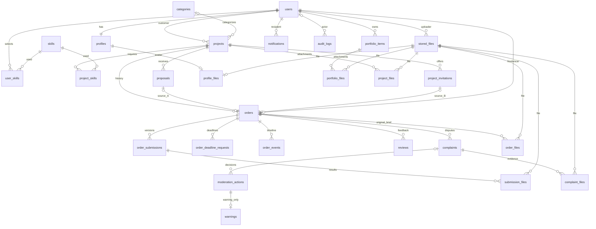

# База данных Workify

Схема PostgreSQL 17 реализует [предметную модель](domain-model.md) и [жизненные циклы](state-transitions.md). Все таблицы приложения находятся в схеме `workify`: 27 предметных таблиц, две таблицы авторизации и служебная `schema_migrations` (30 всего). SQL выполняется через `pg` в слое repositories/DAO; ORM не требуется.

## Миграции и воспроизводимая проверка

Из корня приложения, с настроенным подключением `psql` к отдельной базе Workify:

```powershell
psql -X -v ON_ERROR_STOP=1 -d workify -f database/migrate.sql
```

Host, user, port и пароль задаются стандартной конфигурацией клиента PostgreSQL (`PGHOST`, `PGPORT`, `PGUSER`, `PGPASSFILE` или интерактивный ввод). Пароль не помещается в команды и Git. База должна существовать, пользователь миграций должен иметь право создавать схему и её объекты. Миграции рассчитаны на PostgreSQL 17 и проверяют major version до изменения схемы. Это не команды запуска всего приложения: [Docker Compose и автоматическое применение миграций](infrastructure.md) добавлены на этапе 03.

[migrate.sql](../database/migrate.sql) берёт advisory lock для сериализации запусков, читает `workify.schema_migrations` и применяет только отсутствующие версии. Каждая миграция и запись о её применении выполняются в одной транзакции. Ошибка не оставляет частично созданные объекты или ложную запись об успехе; повторный запуск продолжает с последней успешной версии. Относительные `\ir` разрешаются от расположения SQL-файла.

| Версия | Содержимое |
|---|---|
| [001](../database/migrations/001_initial_schema.sql) | Таблицы, PK/FK/CHECK/UNIQUE, обязательные частичные уникальные индексы, служебные триггеры времени и неизменяемых журналов |
| [002](../database/migrations/002_indexes_and_views.sql) | Индексы выборок и пять представлений; в этой же транзакции применяется [справочный seed](../database/seeds/reference_data.sql) |
| [003](../database/migrations/003_auth_sessions.sql) | Отзывные auth_sessions и хеши одноразовых refresh token; consumed_at сохраняется для обнаружения replay |

Применённые миграции не редактируются. Для последующих изменений добавляется следующая версия и её включение в migrate.sql. Миграции не выполняют DROP/TRUNCATE рабочих данных; откат изменения схемы оформляется отдельной осмысленной миграцией. Начальное создание схемы и журнала также транзакционно.

Воспроизводимый набор проверок без npm-зависимостей:

```powershell
node scripts/test-database.mjs
```

Нужны Node.js и работающий Docker Engine. [Runner](../scripts/test-database.mjs) создаёт отдельный `postgres:17-alpine` без опубликованных портов, сети и монтирования пользовательских данных. Данные размещаются в tmpfs; контейнер удаляется в finally с проверкой собственной метки. `trust` применяется только внутри этого изолированного тестового контейнера и не является конфигурацией рабочей базы. Образ при первом запуске скачивается Docker; его можно заранее загрузить через `docker pull postgres:17-alpine`. Переменная `WORKIFY_TEST_POSTGRES_IMAGE` позволяет выбрать другой образ именно PostgreSQL 17.

Проверяются чистое развёртывание, повторный запуск миграций, 57 положительных/отрицательных проверок ограничений, обе ссылки-источника заказа, представления и рейтинги, повторный seed с сохранением id, атомарный откат специально повреждённой копии миграции и восстановление. Два независимых сеанса PostgreSQL одновременно создают заказы из proposal и invitation: ожидается один успех и одна ошибка уникальности активного заказа. Затем отмена сохраняет историю и освобождает проект для нового заказа. Это проверки схемы; авторизация и полный workflow API будут проверяться после реализации сервисов.

SQL-проверки находятся в [constraints.sql](../database/tests/constraints.sql) и [views_and_seed.sql](../database/tests/views_and_seed.sql). Их фикстуры откатываются; тест конкурентности существует только до удаления контейнера. Тесты не подключаются к локальным пользовательским базам.

## Типы, ключи и хранение

- Идентификаторы — UUID с `gen_random_uuid()`, без дополнительных extensions. FK имеют тот же тип. UUID передаются JavaScript как строки, без потери точности.
- Время — `timestamptz`, включая дедлайны; даты сравниваются по серверному времени. `created_at` сохраняется, `updated_at` обслуживается механическим BEFORE UPDATE trigger. Сроки, которые должны быть в будущем на момент действия, дополнительно проверяются сервисом.
- Статусы — ограниченные `varchar` с CHECK по согласованным наборам. Роль аккаунта — только CLIENT/ADMIN; customer/freelancer хранятся как стороны конкретного взаимодействия.
- Стоимость и бюджет — `numeric(12,2)`, положительные при заполнении. Это справочные условия; платёжных таблиц и состояний нет. `pg` возвращает numeric строками, и будущий код не должен терять точность преобразованием денежных значений в float.
- Регистронезависимая уникальность email/username обеспечена индексами `lower(...)`; нормализацию ввода и безопасное хеширование пароля выполняет сервис. Профиль содержит только пользовательские данные, пароль — только users.password_hash.
- skills/categories имеют стабильный уникальный slug. Связи user_skills/project_skills имеют составной PK. Seed создаёт 8 категорий и 20 навыков, без пользователей, паролей или демонстрационных заказов; повтор не заменяет существующие id.
- Внешние ссылки результата/портфолио — массивы text; допустимые схемы URL, количество и длину валидирует сервис. JSONB предназначен для метаданных событий/аудита, а не для основных связей и бинарных файлов.
- `stored_files` хранит автора, basename storage_key, исходное имя, MIME и положительный размер. Ключ запрещает разделители каталогов и `..`. Содержимое файлов хранится в volume `uploads_data`, не в PostgreSQL.

## Основные связи



Диаграмма показывает предметные связи; обязательное создание пары users/profiles выполняется транзакцией регистрации, а PK profiles.user_id ограничивает её одним профилем. Каждая order имеет ровно один из двух необязательных по отдельности источников. Связи заказчика/исполнителя, автора/адресата отзывов и жалоб раскрыты ниже составными FK и CHECK.

## Гарантии ограничений БД

| Область | Гарантия |
|---|---|
| Владение проектом | UNIQUE(project.id, customer_id) и составные FK из proposals, invitations и orders не позволяют подменить заказчика |
| Источник заказа | XOR `num_nonnulls(proposal_id, invitation_id) = 1`; UNIQUE каждой ссылки исключает повторное использование; составные FK сверяют источник, проект и обе стороны |
| Активный заказ | Частичный UNIQUE(project_id) для IN_PROGRESS/SUBMITTED/REVISION_REQUESTED работает и между конкурентными транзакциями; обычного UNIQUE(project_id) нет |
| Исторические заказы | CANCELLED не входит в активный индекс; COMPLETED имеет отдельный частичный UNIQUE на проект. Все заказы остаются в orders |
| Отклики/приглашения | Не более одного PENDING для пары проект/исполнитель; запрет самому себе; положительные цены, сроки, согласованность status/decided_at |
| Отмена | Для CANCELLED обязательны время, причина и одна из сторон заказа в cancelled_by; для остальных статусов поля отмены пусты |
| Версии | UNIQUE(order_id, version), один SUBMITTED и один ACCEPTED на заказ; составные FK проверяют автора-исполнителя и проверяющего-заказчика; доработка требует комментарий |
| Запросы срока | Один PENDING на заказ; автор — исполнитель; решающий — заказчик; предложенная дата отличается от прежней; отказ/истечение имеют причину |
| Отзывы/жалобы | Составной FK сверяет сохранённые customer_id/freelancer_id с заказом; CHECK определяет обе допустимые направленности, исключая себя и постороннего; UNIQUE(order_id, автор) |
| Жалоба | NEW без обработчика; IN_REVIEW/терминальная с назначенным обработчиком и датой; закрытая жалоба с обоснованием и датой решения |
| Предупреждения | Составной FK сверяет WARNING action, получателя и администратора; одна warning на action; одна complaint может иметь санкции обеим сторонам |
| История и файлы | Предметные FK используют RESTRICT; DELETE связанных файлов запрещён; audit_logs/order_events/moderation_actions отклоняют UPDATE/DELETE/TRUNCATE |

Сохранённые customer_id/freelancer_id в proposals, invitations, orders, reviews и complaints — контролируемое дублирование для составных FK. Они не заменяют источник истины и не должны приниматься из произвольных клиентских полей.

CASCADE используется только для зависимых связей удаляемого черновика/портфолио/профиля: навыков проекта и файловых ссылок. Бинарный файл при этом автоматически не удаляется. На исторических order_files/submission_files/complaint_files каскадного удаления нет. Удаление исторических ссылок и изменение содержания сдачи/доказательств также запрещаются правилами будущего сервиса.

## Представления и индексы

| Представление | Назначение |
|---|---|
| `v_active_orders` | Активные статусы и вычисляемый `is_overdue`; истечение срока не меняет статус |
| `v_order_history` | COMPLETED/CANCELLED из той же orders, без переноса в архив |
| `v_user_ratings` | Отдельные оценки и количества полученных отзывов как заказчика/исполнителя; скрытые отзывы исключены; без оценок — NULL и 0 |
| `v_public_profiles` | Публичные поля CLIENT, аватар и рейтинги; без email, телефона, хеша и причин блокировки; истёкшая временная блокировка не скрывает профиль |
| `v_user_sanctions` | История WARNING/TEMPORARY_BLOCK/PERMANENT_BLOCK со связанным warning и жалобой |

Представления не заменяют авторизацию: repositories обязаны фильтровать заказы по customer_id или freelancer_id текущего пользователя, санкции и уведомления — по получателю. Публичное представление не является правом выполнять действия для заблокированного аккаунта.

Индексы покрывают каталог OPEN по дате/категории, русскоязычный полнотекстовый поиск, проекты заказчика, отклики и приглашения, заказы обеих сторон по статусу, хронологию, очередь жалоб, отзывы получателя, непрочитанные уведомления, аудит по времени/автору/сущности и обратные файловые ссылки. Уникальные индексы ограничений создаются в 001; индексы выборок — в 002.

## Граница между схемой и сервисами

БД обеспечивает структурную целостность, но не распознаёт авторизованного пользователя из HTTP-сессии. Принадлежность роли ADMIN, активность сторон в момент команды, допустимый переход статуса, PENDING/OPEN перед принятием, терминальный order для отзыва/жалобы, последняя версия при приёмке и санкции именно участникам жалобы проверяются сервисом под соответствующими блокировками.

Сервис обязан одной транзакцией синхронизировать статусы project/order, принятие источника и закрытие конкурирующих pending, решение по сроку и deadline, приёмку версии, events, audit и notifications. Триггеры не выполняют эти переходы автоматически. Схема позволяет обновить две связанные строки последовательно внутри транзакции, не требуя временно нарушать обычные FK.

Тот же сервис отвечает за нормализацию URL, допустимые MIME/размеры, права на загрузку и доступ к файлам, неизменяемость исторического содержимого, безопасное формирование аудита без секретов, обязательный профиль при регистрации и механизм прекращения блокировок. Прямой SQL-доступ клиента не предоставляется; права пользователей проверяются backend.

## Историческая база

Перед проектированием сопоставлены старые `db/tables.sql`, `db/views.sql` курсового по БД, ООП `Note/database scripts/new_tables.sql`, `new_views.sql`, модели `DAL/Models/Tables/Order.cs`, `Complaint.cs`, `Review.cs`, а также СТАРИС `lab05/db_query.sql`. Полные корни источников приведены в [предметной модели](domain-model.md).

Сохранены проекты, две стороны заказа, направленные отзывы, жалобы с контекстом и административные решения. Заменены старые UNIQUE на всех orders.project_id, orders_archive, приглашения внутри notifications, binary-аватар и связи жалобы одновременно с активной/архивной таблицей. SQL Server, старые платёжные таблицы и Entity Framework из прежних материалов в текущую схему не переносятся.
