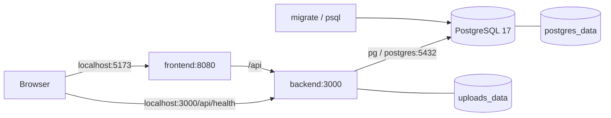

# Запуск и инфраструктура Workify

Docker Compose запускает три постоянных сервиса — frontend, backend и PostgreSQL 17 — и одноразовый migrate. Миграции 001/002 сохранены; 003 добавляет сессии, 004 — контрольную сумму и отложенное удаление файлов. [Каркас backend](backend.md) расширен [авторизацией](auth.md), [профилем/навыками](profile.md), [FileService/портфолио](files-and-portfolio.md) и [проектами](projects.md). Реализованы [заказы](orders.md), [модерация](administration.md), [аудит](audit.md) и [уведомления](notifications.md).

## Быстрый запуск

Нужен работающий Docker Engine с Docker Compose; на Windows подходит Docker Desktop в режиме Linux containers. Node.js нужен на хосте только для вспомогательных скриптов; приложение собирается и работает внутри контейнеров Node.js 24 LTS.

Из корня репозитория:

```powershell
node scripts/setup-env.mjs
docker compose up --build -d --wait
```

[setup-env.mjs](../scripts/setup-env.mjs) создаёт `.env` из [.env.example](../.env.example), генерируя случайные секреты PostgreSQL и JWT. Скрипт не печатает секреты; в существующий файл дописывается только отсутствующий AUTH_JWT_SECRET. `.env` игнорируется Git и не входит в build contexts приложений. При ручной настройке нужны собственные POSTGRES_PASSWORD и 32 случайных байта AUTH_JWT_SECRET в hex; placeholder из примера для запуска не подходит.

- [Frontend](http://localhost:5173) — стартовая страница React с проверкой подключения.
- [Backend health](http://localhost:3000/api/health) — готовность API, PostgreSQL и каталога файлов.
- [Health через frontend](http://localhost:5173/api/health) — тот же запрос через внутреннее проксирование.

Для запуска с выводом логов в текущий терминал используется `docker compose up --build`. Обычный `docker compose down` останавливает и удаляет контейнеры, сохраняя оба именованных volume. Следующий `docker compose up -d --wait` использует сохранённые данные.

## Сервисы и порядок запуска

| Сервис | Назначение | Готовность и зависимости |
|---|---|---|
| `postgres` | Официальный postgres:17-alpine, данные в postgres_data | pg_isready через TCP; порт БД не публикуется на хост |
| `migrate` | Тот же PostgreSQL image запускает psql и [database/migrate.sql](../database/migrate.sql) | Ждёт здоровый postgres; завершается с кодом 0 после успешных миграций |
| `backend` | Express и pg, Node.js 24, порт контейнера 3000 | Ждёт postgres и успешный migrate; GET /api/health выполняет SELECT 1 через repository и проверяет доступ к uploads |
| `frontend` | Собранный React, отдельный сервер статики и API proxy, порт контейнера 8080 | Ждёт здоровый backend; собственный /healthz проверяет доступность сервера frontend |



[compose.yaml](../compose.yaml) не задаёт container_name: имена и volumes относятся к Compose project, что позволяет поднимать независимый тестовый проект. По умолчанию проект называется workify. Публикуемые frontend/backend порты привязаны к loopback хоста; браузер обращается к API по относительному `/api`, а имя Docker-сервиса `backend` используется только сервером frontend. CORS для этого пути не требуется.

Frontend собирается Vite через `npm ci` и `npm run build`. В runtime image остаются dist и необходимые серверные зависимости, без Vite/dev server. Express отдаёт статику и SPA fallback; http-proxy-middleware передаёт `/api` в backend с сохранением префикса. Ошибки backend не подменяются index.html, отсутствующие assets возвращают 404. Nginx не требуется.

Контейнеры приложений работают от пользователя node с uid 1000. В backend заранее создан принадлежащий ему `/app/uploads`; named volume сохраняет возможность записи. Запуск через init и обработка SIGTERM позволяют корректно останавливать процессы; backend закрывает HTTP server и pg pool.

## Конфигурация

| Переменная .env | Значение по умолчанию / назначение |
|---|---|
| COMPOSE_PROJECT_NAME | workify; префикс имён ресурсов Compose |
| POSTGRES_DB | workify |
| POSTGRES_USER | workify |
| POSTGRES_PASSWORD | Генерируется setup-env; обязательна для Compose |
| FRONTEND_PORT | 5173 на хосте, 8080 внутри контейнера |
| BACKEND_PORT | 3000 на хосте и в контейнере |

Backend получает PGHOST=postgres, PGPORT=5432, PGDATABASE/PGUSER/PGPASSWORD из Compose и UPLOAD_DIR=/app/uploads. Эти значения не включаются в браузерную сборку. Порт хоста меняется через .env; внутренние адреса сервисов от этого не меняются.

Изменение пароля в .env само по себе не меняет пароль роли в уже созданной PostgreSQL-базе: POSTGRES_* используется образом при первоначальном создании кластера. Поэтому setup-env сохраняет существующий файл. Для обычного продолжения работы используются прежние настройки и volumes.

## Миграции и постоянное хранение

`migrate` монтирует каталог database как read-only `/migrations`. Он использует PostgreSQL credentials из environment и подключается по имени postgres. Миграции применяются через имеющийся журнал версий и advisory lock. Ошибка миграции останавливает запуск backend; успешный повтор не пересоздаёт таблицы, seed или идентификаторы. Для явного применения новых миграций:

```powershell
docker compose run --rm migrate
```

| Volume | Путь контейнера | Содержимое |
|---|---|---|
| postgres_data | postgres:/var/lib/postgresql/data | Кластер, таблицы, справочники и журнал миграций |
| uploads_data | backend:/app/uploads | Будущие загружаемые файлы, независимо от жизни контейнера |

При стандартном имени проекта Docker создаёт workify_postgres_data и workify_uploads_data. Пересоздание `docker compose up -d --force-recreate --wait` заменяет контейнеры, сохраняя volumes. Каталог uploads не раздаётся как публичная статика: FileService проверяет доступ к каждому вложению. В БД остаются только метаданные файлов.

## Health и диагностика

Успешный `GET /api/health` возвращает HTTP 200:

```json
{"status":"ok","checks":{"database":"up","uploads":"up"}}
```

Если БД или каталог файлов недоступны, ответ — HTTP 503, status=error и down для соответствующей проверки. В ответе нет пароля, connection string или текста ошибки драйвера. Pool имеет ограниченные таймауты и самостоятельно восстанавливает соединения после возврата PostgreSQL. Health не кэшируется.

При остановленном backend сервер frontend продолжает отдавать страницу, а API proxy возвращает HTTP 502 с безопасным JSON-сообщением. Собственный `/healthz` frontend показывает доступность статики, а не готовность всей системы. React выводит результат актуальной проверки и позволяет повторить запрос.

Полезные команды:

```powershell
docker compose ps -a
docker compose logs --tail 100 backend frontend migrate
docker compose exec postgres psql -U workify -d workify
```

`migrate` в состоянии Exited (0) — нормальное успешное завершение. Если POSTGRES_USER/POSTGRES_DB изменены, в команде psql используются значения из своего .env. Backend не требует локального PostgreSQL и не подключается к localhost внутри контейнера.

## Проверки инфраструктуры

```powershell
node scripts/test-infrastructure.mjs
```

[Smoke runner](../scripts/test-infrastructure.mjs) использует отдельный случайный Compose project, самостоятельные credentials и свободные loopback-порты. Он не читает рабочий .env и не подключается к основным volumes. Проверяются:

1. Сборка, здоровый запуск, Node.js 24, PostgreSQL 17, восемь миграций, таблицы и seed.
2. Frontend HTML/JS/CSS, SPA fallback, API proxy, отсутствие доступа к .env и uploads.
3. Запись маркеров в БД и файловый volume, реальная замена контейнеров, сохранность обоих маркеров и неизменность журнала миграций.
4. HTTP 503 при остановке PostgreSQL и восстановление соединения после старта.
5. HTTP 502 при остановке backend, доступность frontend и восстановление proxy.

В finally удаляются только ресурсы тестового проекта с проверкой project labels: контейнеры, его тестовые volumes и его image tags. Основной workify продолжает работать. Проверки самой схемы отдельно запускаются `node scripts/test-database.mjs` и описаны в [документации БД](database.md).

Runner также проверяет JSON 404 с requestId через frontend proxy. Набор включает 90 unit-тестов backend, 141 интеграционный тестов на своей отдельной базе и 8 frontend-тестов. Через реальные контейнеры проверяются cookie, первый ADMIN, профиль/навыки/приватность контактов, принятие отклика и приглашения с созданием заказов, их приватные списки/детали/матрица прав и сохранность после пересоздания backend. Тестовые маршруты создаются только внутри набора и не публикуются приложением.

Стартовая страница, формы авторизации, профиль, портфолио, проекты, отклики, приглашения и заказы проверяются в браузере, включая узкую ширину, загрузку файлов, публикацию, редактирование, поиск, историю/reload, выход и гостевой просмотр. Smoke загружает файлы через API, привязывает к работе портфолио и проекту, принимает отклик/приглашение, согласует срок, сдаёт две версии с доработкой и принимает результат. После реальной замены контейнеров проверяются байты соглашения/результата, замечания, решения срока, версии и завершённые order/project. Smoke также отменяет заказ, повторно назначает проект и проверяет старую ленту событий после замены контейнеров. Аудируемые браузерные сценарии запускаются в отдельном временном Compose-проекте, удаляемом целиком после проверки.

## Связь с предыдущими работами

Изучены ППО `lab06/lab06-ppo-deployment diagram.drawio`, README ООП-приложения и старый `db/init.sql`; дополнительно сопоставлены `_материалы/Workify_STSR_Project_Specification_v4/infra/README.md` и `docs/06_system_architecture.md`. Корни исторических источников приведены в [предметной модели](domain-model.md).

Сохранено разделение browser → API → PostgreSQL и файлового хранилища. Старые ASP.NET/EF, отдельный storage server/S3, moderator, платежи и демонстрационные пароли не переносятся. Для текущей курсовой используются React/Express/pg, два named volumes и роли CLIENT/ADMIN; файлы доступны через общий FileService.

Версии runtime и поведение сервера статики сверены с [официальной таблицей Node.js releases](https://nodejs.org/en/about/previous-releases) и [документацией Vite о static deployment](https://vite.dev/guide/static-deploy.html). Синтаксис маршрутов и proxy — с [Express 5](https://expressjs.com/en/guide/migrating-5/) и [http-proxy-middleware](https://github.com/chimurai/http-proxy-middleware).
