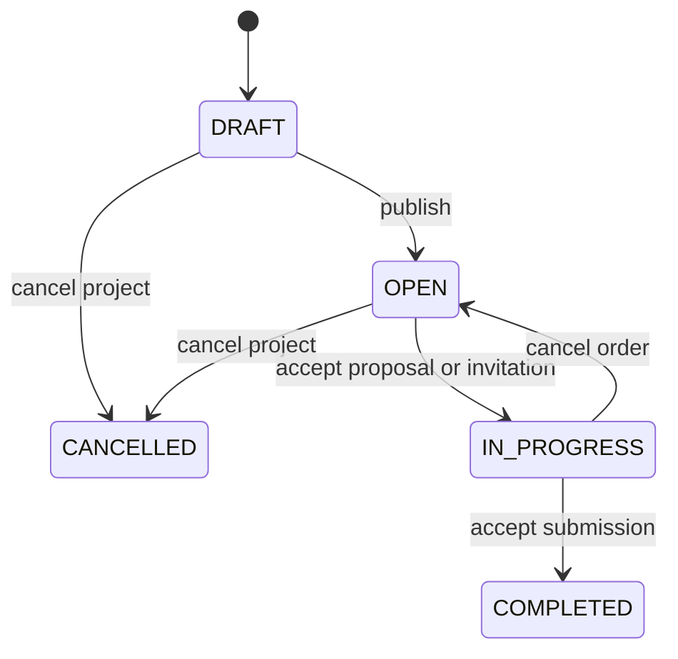
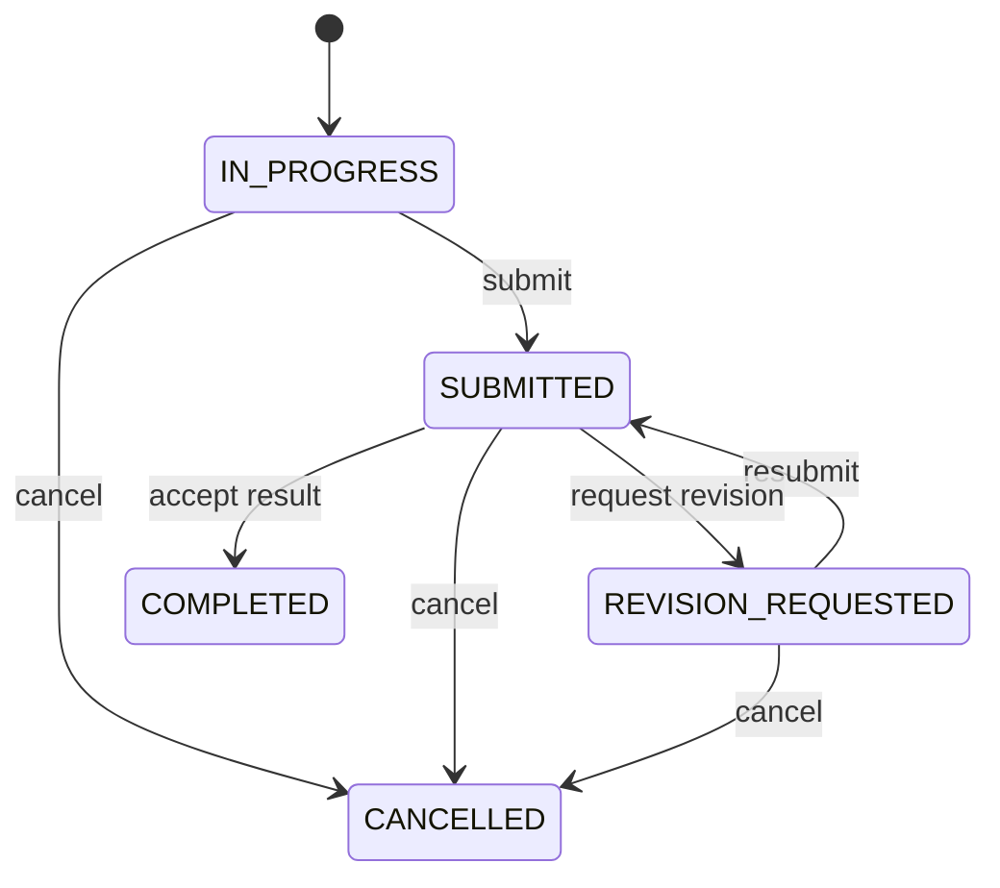
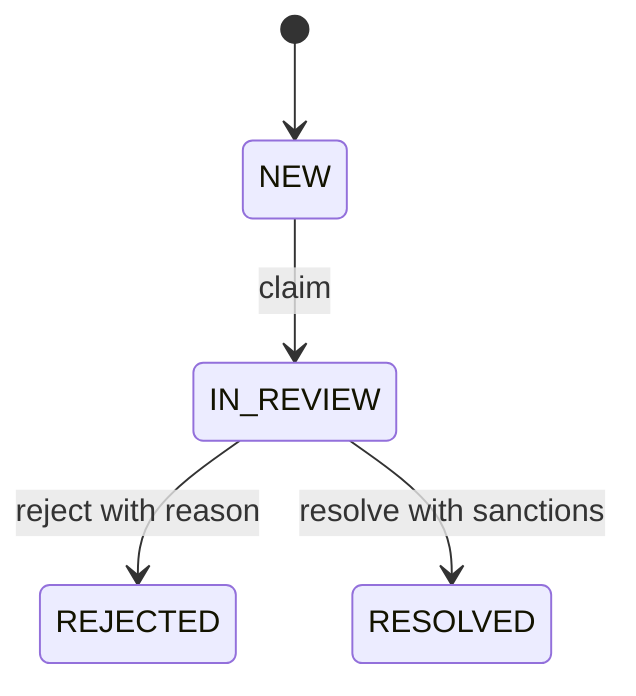

# Статусы и переходы Workify

Документ дополняет [предметную модель и матрицу прав](domain-model.md). Каждый переход — именованное действие сервиса с проверкой сессии, актуальной роли, блокировки, участия и текущего состояния. Отсутствующий в таблицах переход запрещён; универсального изменения status нет.

`∅` обозначает создание, «система» — внутренний код сервиса в результате разрешённого действия или истечения срока. Клиент не может вызвать системный переход, передав нужный статус. Все время и сроки проверяются по часам сервера; в хранилище используются однозначные временные отметки, в интерфейсе — локальное представление.

## 1. Общие инварианты

| Код | Обязательное правило |
|---|---|
| I1 | У проекта не более одного активного order. Активные статусы: `IN_PROGRESS`, `SUBMITTED`, `REVISION_REQUESTED`; терминальные: `COMPLETED`, `CANCELLED` |
| I2 | `project.IN_PROGRESS` эквивалентен существованию одного активного order этого проекта; в остальных статусах проекта активных заказов нет |
| I3 | `order.COMPLETED` означает `project.COMPLETED`; завершённый проект имеет ровно один успешно завершённый заказ и может иметь прежние отменённые |
| I4 | Отмена активного заказа сохраняет его как `CANCELLED` и возвращает проект в `OPEN`. Окончательная отмена проекта — отдельная команда владельца из DRAFT/OPEN |
| I5 | Заказчик заказа — владелец проекта; исполнитель отличается от заказчика. Стороны, проект, источник и первоначальное соглашение заказа не меняются |
| I6 | У каждого заказа ровно один принятый источник: proposal либо invitation. Один источник создаёт не более одного заказа, в том числе после отмены |
| I7 | Терминальные сущности не возвращаются в активное состояние. Новое соглашение после отмены — новый источник и новый order; исторические записи не удаляются |
| I8 | Принятие источника, изменение project/order, закрытие несовместимых pending, события, аудит и уведомления сохраняются одной транзакцией PostgreSQL |
| I9 | Приёмка возможна только для последней SUBMITTED-версии и только заказчиком. Исполнитель не принимает свою работу; ADMIN не подменяет стороны |
| I10 | Дедлайн изменяется только одобрением запроса заказчиком; истечение дедлайна не меняет статус и не отменяет заказ |
| I11 | Отзыв/жалоба возможны только по COMPLETED/CANCELLED order между его сторонами; адресат вычисляется сервером, по одному объекту каждого вида на пару order/автор |

На этапе 02 I1 должен дополнительно защищаться ограничением БД, например частичным уникальным индексом по project_id активных orders. Одной проверки перед INSERT недостаточно. Межтабличные правила обеспечиваются транзакциями сервисов и повторной проверкой под блокировкой.

## 2. Project

| Статус | Смысл |
|---|---|
| `DRAFT` | Черновик владельца, вне публичного каталога |
| `OPEN` | Опубликованное задание, доступное для нового соглашения |
| `IN_PROGRESS` | Имеет один активный заказ |
| `COMPLETED` | Последняя работа принята, проект завершён |
| `CANCELLED` | Владелец окончательно отменил проект без активного заказа |

| Из | В | Действие | Исполнитель и условия | Последствия |
|---|---|---|---|---|
| ∅ | DRAFT | Создать проект | Активный CLIENT | Сервер назначает текущего пользователя владельцем |
| DRAFT | OPEN | Опубликовать | Владелец; заполнены заголовок, описание, категория и корректные условия | Проект появляется в каталоге |
| DRAFT | CANCELLED | Отменить проект | Владелец; непустая причина | Сохраняются причина, автор и время; в каталог не попадает |
| OPEN | CANCELLED | Отменить проект | Владелец; нет активного заказа; причина | Все PENDING proposals -> REJECTED, invitations -> EXPIRED с причиной PROJECT_CANCELLED |
| OPEN | IN_PROGRESS | Принять отклик/приглашение | Заказчик принимает proposal либо адресат принимает invitation; источник PENDING, стороны активны, условия актуальны, нет активного заказа | Создаются order IN_PROGRESS и его соглашение; остальные pending закрываются |
| IN_PROGRESS | OPEN | Отменить активный заказ | Любая его активная сторона; причина | Order CANCELLED остаётся в истории; старые источники не возобновляются |
| IN_PROGRESS | COMPLETED | Принять последнюю сдачу | Заказчик; order SUBMITTED и последняя версия не рассмотрена | Order COMPLETED; проект уходит из OPEN-каталога |

Редактирование не является сменой статуса. Владелец редактирует DRAFT/OPEN; изменение задания, условий или вложений опубликованного проекта в той же транзакции закрывает PENDING proposals как REJECTED, invitations как EXPIRED с причиной TERMS_CHANGED. Старые заказы и их файлы остаются доступными сторонам по снимку условий. Изменение DRAFT не закрывает ничего. Проект IN_PROGRESS/COMPLETED/CANCELLED не редактируется.

Физическое удаление допустимо только для DRAFT без зависимых предметных записей. В остальных случаях используется отмена с сохранением истории. Отмена order всегда сначала возвращает проект в OPEN; если заказчик хочет окончательно отказаться от задания, он отдельно отменяет OPEN project.

## 3. Proposal

| Статус | Смысл |
|---|---|
| `PENDING` | Ожидает решения заказчика |
| `ACCEPTED` | Принят и связан с созданным заказом |
| `REJECTED` | Отклонён владельцем либо закрыт системой как неактуальный |
| `WITHDRAWN` | Автор отозвал отклик |

| Из | В | Действие | Исполнитель и условия | Последствия |
|---|---|---|---|---|
| ∅ | PENDING | Подать отклик | Активный CLIENT на чужой OPEN; владелец активен; нет PENDING этой пары; сообщение и будущий срок | Заказчик получает уведомление; order ещё не существует |
| PENDING | ACCEPTED | Принять отклик | Владелец OPEN; автор активен; условия актуальны; нет активного заказа | Одна транзакция назначения: order IN_PROGRESS, project IN_PROGRESS |
| PENDING | REJECTED | Отклонить отклик | Владелец OPEN | Сохраняется решение; автор получает уведомление |
| PENDING | REJECTED | Закрыть неактуальный отклик | Система при принятии любого источника, отмене/изменении проекта либо устаревшем предложенном сроке | Причина OTHER_SOURCE_ACCEPTED, PROJECT_CANCELLED, TERMS_CHANGED или TERMS_EXPIRED; история сохраняется |
| PENDING | WITHDRAWN | Отозвать | Автор отклика | Новый отклик возможен только на OPEN с актуальными условиями |

ACCEPTED, REJECTED и WITHDRAWN — терминальные статусы. После отмены созданного заказа принятый proposal остаётся ACCEPTED, остальные не становятся PENDING. Если стороны договорились снова, создаётся новый proposal либо invitation. Существование отклика и приглашения одной паре одновременно допустимо; принятие одного закрывает другое.

## 4. Invitation

| Статус | Смысл |
|---|---|
| `PENDING` | Ждёт ответа исполнителя |
| `ACCEPTED` | Адресат принял, создан заказ |
| `DECLINED` | Адресат отказался |
| `EXPIRED` | Срок ответа/условия устарели либо проект больше не доступен для приглашения |

| Из | В | Действие | Исполнитель и условия | Последствия |
|---|---|---|---|---|
| ∅ | PENDING | Пригласить исполнителя | Владелец OPEN; другой активный CLIENT; нет PENDING этой пары; сообщение, будущий срок работы и срок ответа при наличии | Создаётся самостоятельное invitation и notification адресату; заказа ещё нет |
| PENDING | ACCEPTED | Принять приглашение | Адресат; свой активный аккаунт и активный заказчик; проект OPEN; сроки не истекли; нет активного заказа | Одна транзакция назначения: order IN_PROGRESS, project IN_PROGRESS |
| PENDING | DECLINED | Отклонить приглашение | Адресат; приглашение ещё актуально | Отправитель получает уведомление |
| PENDING | EXPIRED | Закрыть приглашение | Система: срок ответа истёк, предложенный срок работы устарел, принят другой источник, проект отменён или задание изменено | Сохраняется причина TIME_EXPIRED, TERMS_EXPIRED, OTHER_SOURCE_ACCEPTED, PROJECT_CANCELLED или TERMS_CHANGED |

ACCEPTED, DECLINED и EXPIRED терминальны. EXPIRED обозначает и утрату актуальности предложения: отдельные REVOKED/CANCELLED для приглашения не вводятся. Прочтение notification не принимает invitation. Отправитель не принимает приглашение за адресата и не создаёт order напрямую.

Истечение проверяется по серверному времени даже без фонового обработчика. При обслуживании приглашений и перед созданием нового предложения сервер фиксирует устаревшие PENDING как EXPIRED; для proposal — REJECTED с TERMS_EXPIRED. Попытка принятия просроченного источника всегда отклоняется. Обновление устаревших записей не должно создавать заказ или повторные уведомления.

## 5. Order

| Статус | Смысл |
|---|---|
| `IN_PROGRESS` | Исполнитель выполняет работу |
| `SUBMITTED` | Последняя версия ожидает решения заказчика |
| `REVISION_REQUESTED` | Заказчик запросил исправления |
| `COMPLETED` | Заказчик принял последнюю версию; терминальный |
| `CANCELLED` | Одна сторона прекратила заказ с причиной; терминальный |

| Из | В | Действие | Исполнитель и условия | Последствия |
|---|---|---|---|---|
| ∅ | IN_PROGRESS | Создать по принятому источнику | Только сервис принятия proposal/invitation; проверки разделов 3/4 | Стороны и соглашение фиксируются; project IN_PROGRESS; событие ORDER_CREATED |
| IN_PROGRESS | SUBMITTED | Сдать результат | Исполнитель; комментарий и хотя бы файл или внешняя ссылка | Создаётся версия 1; pending запрос срока закрывается; событие SUBMISSION_CREATED |
| REVISION_REQUESTED | SUBMITTED | Повторно сдать | Исполнитель; новая версия и содержимое результата | Предыдущие версии не меняются; pending запрос срока закрывается; SUBMISSION_CREATED |
| SUBMITTED | REVISION_REQUESTED | Запросить доработку | Заказчик; последняя SUBMITTED-версия; непустой комментарий | К версии привязываются решение и комментарий; REVISION_REQUESTED event |
| SUBMITTED | COMPLETED | Принять результат | Заказчик; последняя SUBMITTED-версия, ещё без решения | Версия ACCEPTED; project COMPLETED; событие ORDER_COMPLETED; уведомление исполнителю |
| IN_PROGRESS | CANCELLED | Отменить / отказаться | Заказчик или исполнитель; непустая причина | Project OPEN; автор, время, причина отмены; событие ORDER_CANCELLED |
| SUBMITTED | CANCELLED | Отменить / отказаться | Заказчик или исполнитель; непустая причина | Project OPEN; последняя нерассмотренная версия CANCELLED; ORDER_CANCELLED |
| REVISION_REQUESTED | CANCELLED | Отменить / отказаться | Заказчик или исполнитель; непустая причина | Project OPEN; история версий сохранена; ORDER_CANCELLED |

У COMPLETED/CANCELLED нет исходящих переходов. Сдача ещё одной версии из SUBMITTED, приёмка из IN_PROGRESS, произвольный COMPLETED и отмена после приёмки запрещены. Новый заказ после отмены получает новый id, а старый доступен в истории с прежними сторонами.

### Действия в каждом статусе

| Статус order | Заказчик | Исполнитель |
|---|---|---|
| IN_PROGRESS | Читать; рассмотреть pending запрос срока; отменить с причиной | Читать; сдать; запросить срок; отказаться с причиной |
| SUBMITTED | Читать; принять последнюю версию; запросить доработку; отменить с причиной | Читать; ждать решения; отказаться с причиной |
| REVISION_REQUESTED | Читать; рассмотреть pending запрос срока; отменить с причиной | Читать; повторно сдать; запросить срок; отказаться с причиной |
| COMPLETED | Читать историю; отзыв/жалоба в пределах уникальности | Читать историю; отзыв/жалоба в пределах уникальности |
| CANCELLED | Читать историю; отзыв/жалоба в пределах уникальности | Читать историю; отзыв/жалоба в пределах уникальности |

ADMIN читает контекст для модерации и не выполняет действия этой таблицы за стороны. Переключение режима не меняет фактическую сторону заказа.

## 6. Версии результата и запросы дедлайна

### Сдача результата

Первая сдача получает version = 1, каждая следующая — предыдущее максимальное значение + 1 под блокировкой заказа. Содержимое версии, автор, комментарий, ссылки и файлы не переписываются. При рассмотрении один раз сохраняются результат, заказчик, время и комментарий решения.

| Из | В | Действие | Исполнитель и условия | Последствия |
|---|---|---|---|---|
| ∅ | SUBMITTED | Создать версию | Исполнитель; order IN_PROGRESS/REVISION_REQUESTED | Order SUBMITTED; появляется новая последняя версия |
| SUBMITTED | REVISION_REQUESTED | Вернуть на доработку | Заказчик; это последняя версия; комментарий | Order REVISION_REQUESTED; версия остаётся в истории с замечаниями |
| SUBMITTED | ACCEPTED | Принять версию | Заказчик; это последняя версия | Order и project COMPLETED |
| SUBMITTED | CANCELLED | Закрыть нерассмотренную версию | Система при разрешённой отмене order | Не означает положительную/отрицательную оценку результата; версия сохраняется |

Рассмотренные версии не получают новых решений. Доработка создаёт новую версию, а не переводит старую обратно в SUBMITTED. Ссылка решения всегда указывает конкретную последнюю версию: гонка двух команд не должна принять старую версию.

### Согласование дедлайна

Начальный deadline берётся из принятого отклика/приглашения. Запрос содержит текущий срок, предлагаемый новый срок и причину; автор — исполнитель. Новый срок должен отличаться от текущего и быть в будущем; дата раньше текущего срока допустима при согласии заказчика. Прямое изменение orders.deadline_at запрещено обеим сторонам.

| Из | В | Действие | Исполнитель и условия | Последствия |
|---|---|---|---|---|
| ∅ | PENDING | Запросить изменение | Исполнитель; order IN_PROGRESS/REVISION_REQUESTED; нет PENDING; будущий отличный срок, причина | Deadline прежний; notification заказчику; DEADLINE_REQUESTED event |
| PENDING | APPROVED | Одобрить | Заказчик; order IN_PROGRESS/REVISION_REQUESTED; предложенный срок всё ещё в будущем; прежний срок совпадает с текущим | Deadline меняется; решение, старый/новый срок, DEADLINE_APPROVED event и notification |
| PENDING | REJECTED | Отклонить | Заказчик; order IN_PROGRESS/REVISION_REQUESTED | Deadline прежний; причина решения, DEADLINE_REJECTED event и notification |
| PENDING | EXPIRED | Закрыть неактуальный запрос | Система: сдача работы, завершение/отмена order, устаревшая дата или изменившийся исходный deadline | Deadline прежний; сохраняется причина закрытия, событие и уведомление исполнителю |

APPROVED/REJECTED/EXPIRED терминальны. Сдача работы закрывает PENDING запрос с причиной ORDER_SUBMITTED, поэтому после сдачи нельзя молча изменить согласованный срок. После доработки исполнитель может создать новый запрос. Отмена и приёмка также закрывают оставшиеся pending в своей транзакции. Устаревший запрос не блокирует создание нового: перед созданием сервис фиксирует его EXPIRED.

`is_overdue = deadline_at < server_now AND order.status IN (IN_PROGRESS, SUBMITTED, REVISION_REQUESTED)` — вычисляемый индикатор, а не статус. Он не запрещает сдачу, доработку, согласование срока или приёмку; просрочка остаётся контекстом истории, отзыва и жалобы. Просроченный терминальный заказ не считается активной просрочкой.

## 7. Complaint и решения администратора

| Статус | Смысл |
|---|---|
| `NEW` | Жалоба подана, обработчик ещё не назначен |
| `IN_REVIEW` | Взята конкретным администратором на рассмотрение |
| `RESOLVED` | Подтверждённое нарушение, решение и санкции сохранены |
| `REJECTED` | Нарушение не подтверждено, сохранено обоснование отказа |

| Из | В | Действие | Исполнитель и условия | Последствия |
|---|---|---|---|---|
| ∅ | NEW | Подать жалобу | Участник COMPLETED/CANCELLED order; нет своей жалобы по нему; причина и описание | Сервер определяет вторую сторону; текст и доказательства фиксируются |
| NEW | IN_REVIEW | Взять в работу | Активный ADMIN; жалоба ещё не назначена | Назначаются admin_id и время; notification заявителю |
| IN_REVIEW | REJECTED | Отклонить жалобу | Назначенный ADMIN; непустое обоснование; санкций по решению нет | Moderation action REJECT, решение и время, audit, notification заявителю |
| IN_REVIEW | RESOLVED | Подтвердить нарушение | Назначенный ADMIN; обоснование; хотя бы одна допустимая санкция стороне заказа | Сохраняются actions, warnings/блокировки, решение, аудит и notifications |

Переходы NEW -> терминальный статус, возврат в NEW/IN_REVIEW и изменение закрытого решения не разрешены. Другой администратор не перехватывает уже назначенную жалобу; отдельный процесс переназначения не входит в текущий объём. Два параллельных claim имеют одного победителя.

Санкции — отдельные записи, а не статусы complaint. WARNING создаёт предупреждение; TEMPORARY_BLOCK требует будущий конечный срок; PERMANENT_BLOCK действует до отдельной разблокировки. Получатель санкции — заявитель или адресат связанного заказа; нельзя наказать произвольного третьего пользователя через эту жалобу. Каждой стороне можно назначить собственное решение. Нельзя одновременно отклонить жалобу и применить санкцию в рамках того же решения.

Решение выполняется одной транзакцией: проверка назначенного ADMIN и IN_REVIEW, actions, warnings/состояние аккаунтов, терминальный статус и обоснование complaint, audit и уведомления. Повторный запрос не создаёт вторые предупреждения. Отдельные блокировка/разблокировка или предупреждение без жалобы требуют ADMIN, причины и аудита; история прежних санкций сохраняется. Разблокировка не открывает завершённые заказы и не отзывает решения по жалобам.

## 8. Границы транзакций и конкурентные действия

### Оба пути назначения исполнителя

1. Начать транзакцию; заблокировать проект и выбранный источник в согласованном порядке, повторно прочитать стороны, их блокировки и актуальность условий.
2. Проверить OPEN, PENDING, полномочия принимающего пользователя, будущий deadline и отсутствие активного заказа. Для invitation также проверить адресата и срок ответа.
3. Перевести выбранный источник в ACCEPTED и создать order IN_PROGRESS с единственным источником и снимком соглашения.
4. Перевести project в IN_PROGRESS; все остальные PENDING proposals -> REJECTED и invitations -> EXPIRED с OTHER_SOURCE_ACCEPTED, включая источник той же пары другого типа.
5. Сохранить ORDER_CREATED, аудит и уведомления. Commit. При ошибке — rollback всех изменений, без частично принятого источника.

Порядок блокировок должен совпадать во всех сервисах, затрагивающих одни и те же project/order/источники/пользователей. При гонке принятия двух откликов либо отклика и приглашения выигрывает одна транзакция; вторая получает конфликт состояния. Ограничение БД дополнительно запрещает второй активный order и повторное использование источника.

### Приёмка и отмена

Для каждой команды блокируются связанные project и order в том же порядке, проверяются фактический статус и сторона, затем сохраняются оба статуса, решение по версии или данные отмены, закрытие pending запросов, event, audit и notifications. Приёмка и отмена, пришедшие одновременно, не могут оставить project OPEN с order COMPLETED либо project COMPLETED с order CANCELLED: второе действие видит терминальный статус и отклоняется.

Повторное принятие источника, сдачи, решение по сроку или жалобе даёт конфликт и не повторяет побочные эффекты. Для отметки notification прочитанным повторный вызов допустим и не меняет первоначальное время прочтения. Фоновая обработка сроков необязательна; команда всегда повторно проверяет время, а закрытие устаревшей записи имеет единственный эффект.

## 9. Сценарии приёмки спецификации

Это проверяемые ожидания для будущих интеграционных/E2E-тестов; на этапе 01 исполняемого приложения ещё нет.

| Сценарий | Ожидаемый результат |
|---|---|
| CLIENT создаёт проект A и откликается на чужой B | Один аккаунт работает в двух режимах; собственный A нельзя выбрать для отклика |
| Заказчик принимает PENDING proposal | Один order IN_PROGRESS; project IN_PROGRESS; источник ACCEPTED; все конкурирующие pending закрыты |
| Адресат принимает PENDING invitation | Тот же результат и ограничения заказа, что при proposal; notification само по себе заказа не создаёт |
| Посторонний принимает invitation или отклик | Отказ без изменения источника, заказа, проекта и файлов |
| Одновременно принимаются proposal и invitation одного проекта | Ровно один активный order; второй запрос получает конфликт |
| Отмена заказа, затем новое соглашение | Первый order CANCELLED сохранён; project OPEN; новый источник создаёт новый order, старый ACCEPTED не используется повторно |
| Заказчик окончательно отменяет OPEN project | Project CANCELLED; pending закрыты; новых откликов/приглашений нет |
| Меняются условия OPEN project с откликами | Project остаётся OPEN; прежние pending закрываются с TERMS_CHANGED; исторические соглашения не изменены |
| Исполнитель сдаёт, получает замечания и сдаёт снова | Версия 1 с решением REVISION_REQUESTED сохранена; версия 2 SUBMITTED; принять можно только версию 2 |
| Исполнитель вызывает приёмку своей работы | Отказ; order и project не меняются |
| Заказчик принимает последнюю сдачу | Версия ACCEPTED, order/project COMPLETED в одной транзакции; оплаты нет; проект не в OPEN-каталоге |
| Приёмка и отмена одновременно | Один согласованный терминальный исход; второе действие не меняет его |
| Исполнитель предлагает новый срок | До одобрения deadline прежний; заказчик approve меняет его, reject сохраняет; история решения остаётся |
| Pending запрос срока, затем сдача работы | Запрос EXPIRED; позднее approve отклоняется и не меняет deadline |
| Срок заказа истёк | Только is_overdue; статус прежний; допустимы сдача, приёмка или явная отмена с причиной |
| Обе стороны терминального order оставляют отзывы | Два направленных отзыва максимум; рейтинг получателя разделён по его роли в заказе |
| Отзыв/жалоба по активному или чужому order, себе либо повторно | Отказ; target из запроса не позволяет подменить вторую сторону |
| ADMIN решает жалобу с санкциями обеим сторонам | Complaint RESOLVED, два обоснованных action, соответствующие warnings/блокировки; контекст заказа сохранён |
| Другой ADMIN решает уже взятую жалобу или решение повторяется | Конфликт/отказ; повторных санкций нет |
| Заблокированный CLIENT использует старую сессию | Обычная работа запрещена; собственная причина блокировки доступна; история и чужие активные действия не переписываются |
| Пользователь читает чужой закрытый файл или удаляет историческое вложение | Отказ FileService; бинарные данные и метаданные сохраняются |

Критерии этапа 01: сущности и связи описаны, для каждого действия указаны сторона и условия, матрица прав зафиксирована, статусы и переходы согласованы с инвариантами и двумя путями создания заказа. Реализация схемы и проверка ограничений на PostgreSQL относятся к этапу 02.
